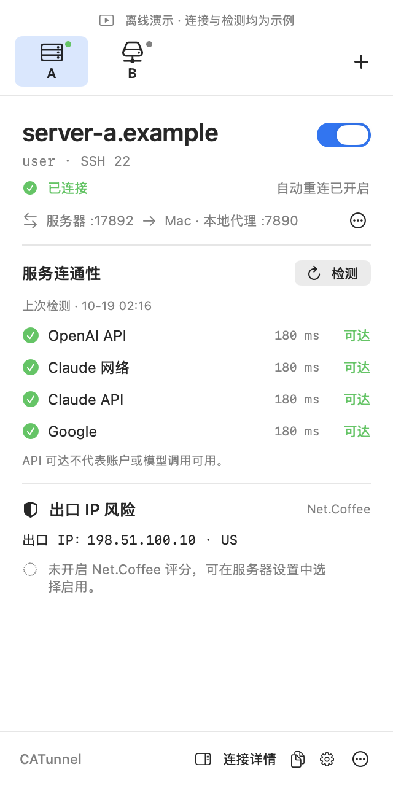
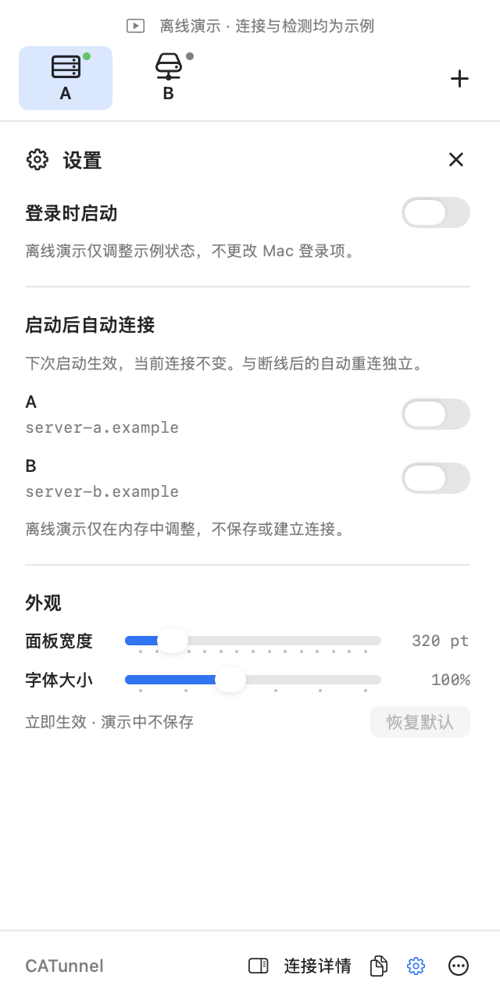
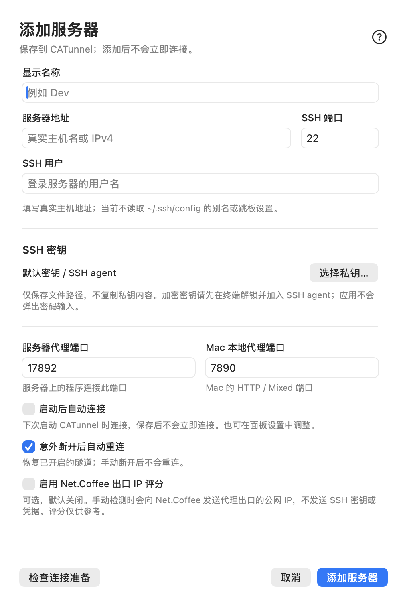
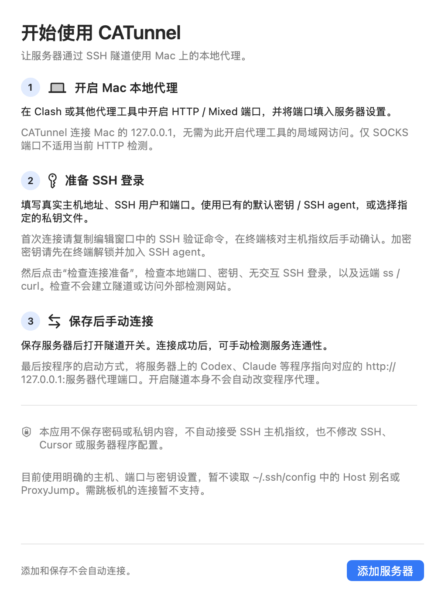

# CATunnel — Coding Agent Tunnel

[简体中文](README.md) · [User guide](docs/USAGE.en.md) · [Agent guide](AGENTS.md)

A lightweight native macOS menu-bar app that lets remote tools such as Codex and Claude
use your Mac's local proxy through an SSH tunnel.

`Remote tool → server loopback port → SSH tunnel → Mac local proxy → Internet`

## Features

- **Multiple servers:** add, edit, remove, and switch profiles from the top tabs.
- **Tunnel controls:** independent connection states, reconnection after interruptions, and per-server startup preferences.
- **Network checks:** OpenAI API, Claude, and Google reachability, plus optional Net.Coffee exit-IP assessments.
- **Native menu-bar UI:** launch at login, adjustable panel width and font size, and a first-use guide.

CATunnel requires an existing HTTP/mixed proxy. Starting a tunnel does not configure remote tools to use it.

## Interface preview

Actual app screenshots in offline mode, with example servers and simulated results.
The current UI is in Chinese. Click an image for full size.

| Menu-bar panel | Startup and appearance |
| :---: | :---: |
|  |  |

More screenshots: server configuration and getting started

| Server configuration | Getting started |
| :---: | :---: |
|  |  |

## Install and get started

Download a preview from [GitHub Releases](https://github.com/YusenHou519/CATunnel/releases):
choose **arm64** for Apple Silicon or **x86_64** for Intel.
Extract the ZIP, move CATunnel.app to Applications, and open its menu-bar icon.

The current preview is **0.6.0-preview.2 (build 5)** with a Chinese UI.
It is not Apple-notarized; if macOS blocks opening it, follow the
[installation guide](docs/USAGE.en.md) without disabling system security protections.

**Requirements:** a local HTTP/mixed proxy on the Mac, and a Linux server with SSH, ss,
curl, key authentication, and reverse forwarding enabled.
The build target is macOS 13+; see [validation coverage](docs/VALIDATION.md) for tested environments and limits.

1. Start your Mac's local proxy and confirm its HTTP/mixed port.
2. Click **+** in CATunnel and enter the host, SSH user, key, and proxy ports.
3. Follow the guide to verify the SSH host fingerprint, run **Check setup** (`检查连接准备`), then save and enable the tunnel.
4. Point your remote tool at the server's proxy address, such as `http://127.0.0.1:17892`.

The default example ports are `7890` on the Mac and `17892` on the server; both are configurable.
First launch starts with an empty server list. See the [user guide](docs/USAGE.en.md)
for configuration, verification commands, and troubleshooting.

SSH aliases, ProxyJump, interactive passwords, and IPv6 host addresses are not yet supported.
API reachability does not prove account or model access. IP scores are optional, off by default, and for reference only.

## TODO

- [ ] English UI.
- [ ] SSH aliases and jump hosts.
- [ ] Profile import, export, and migration design.
- [ ] Homebrew installation and update experience.

See [ROADMAP.md](ROADMAP.md) for priorities, design candidates, and acceptance checks.
Distribution is through GitHub; there is no App Store plan.

## Documentation and contributing

| Document | Contents |
| --- | --- |
| [User guide](docs/USAGE.en.md) | Installation, SSH setup, proxy configuration, startup, and troubleshooting |
| [AGENTS.md](AGENTS.md) | Configuration format, commands, verification, and operating guidance for AI agents |
| [Contributing](CONTRIBUTING.md) | Building, offline demos, checks, and project structure |
| [Validation](docs/VALIDATION.md) / [Releasing](docs/RELEASING.md) | Observed coverage and packaging |
| [Changelog](CHANGELOG.md) | Version history |

Feedback and feature requests are welcome in [Issues](https://github.com/YusenHou519/CATunnel/issues).

[MIT License](LICENSE) · [Acknowledgments](ACKNOWLEDGMENTS.md)
