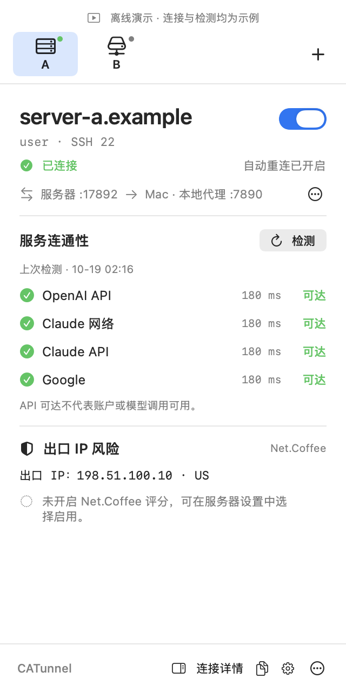
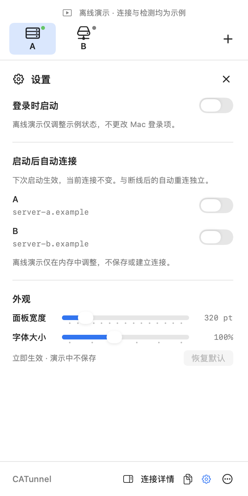
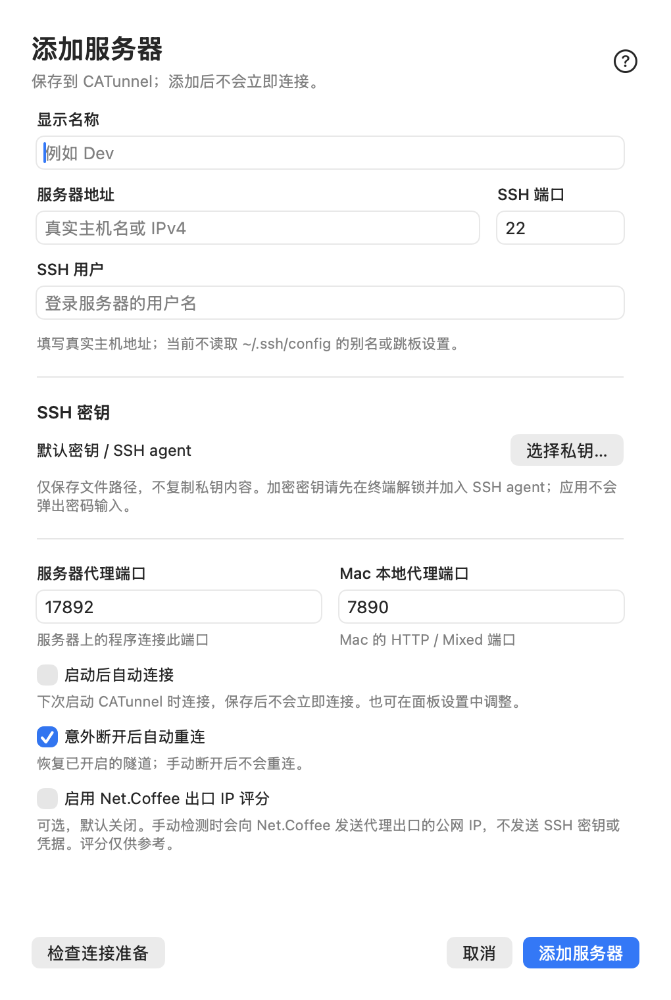
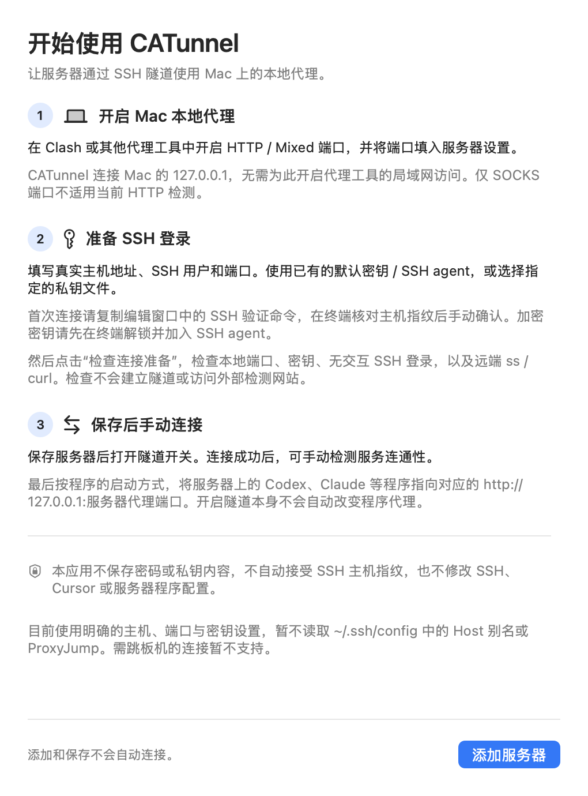

  

<h1> CATunnel — Coding Agent Tunnel</h1>

[Project website](https://yusenhou519.github.io/CATunnel/?lang=en) · [简体中文](README.md) · [User guide](docs/USAGE.en.md) · [Agent guide](AGENTS.md)

A lightweight native macOS menu-bar app that lets remote tools such as Codex and Claude
use your Mac's local proxy through an SSH tunnel.

`Remote tool → server loopback port → SSH tunnel → Mac local proxy → Internet`

## Project website and how it works

Visit the [bilingual project website](https://yusenhou519.github.io/CATunnel/?lang=en)
for features, interface previews, setup instructions and downloads.

**[Play the traffic animation →](https://yusenhou519.github.io/CATunnel/?lang=en#how-it-works)**
Follow a request through the server entry, SSH tunnel and Mac proxy to its destination,
then watch the response return. Pause, advance one step or replay at your own pace.
This is an illustration; it does not send real network requests.

## Features

- **Multiple servers:** add, edit, remove, and switch profiles from the top tabs.
- **Automatic SSH sync:** off by default; when enabled, reads server parameters from `~/.ssh/config` at startup and while running. New profiles do not connect automatically.
- **One-time SSH scan:** **Scan and update once** (`扫描并更新一次`) reads SSH configuration and updates local profiles, even with automatic sync off.
- **Menu-bar visibility:** independently choose which servers appear in the panel, with all visible by default; hiding does not change tunnels, startup connections, or access from connection details.
- **Tunnel controls:** independent connection states, reconnection after interruptions, and per-server startup preferences.
- **Recovery options:** close owned SSH processes before sleep and resume eligible connections on wake; optional forwarding retries every 60 seconds, off by default.
- **Fixed entry (experimental):** an optional remote relay keeps the entry port open, with in-app installation, discovery and selection of existing Python interpreters, and an explicit read-only status check.
- **Network checks:** OpenAI API, Claude, and Google reachability with optional Net.Coffee assessments; a Ping0 button opens its website in the default browser.
- **Native menu-bar UI:** launch at login, adjustable panel width and font size, and a first-use guide.

CATunnel requires an existing HTTP/mixed proxy. Starting a tunnel does not configure remote tools to use it.

## Interface preview

Actual app screenshots in offline mode, with example servers and simulated results.
The current UI is in Chinese. Click an image for full size.

| Menu-bar panel | Startup and appearance |
| :---: | :---: |
|  |  |

More screenshots: server configuration and getting started

| Server configuration | Getting started |
| :---: | :---: |
|  |  |

## Install and get started

Download **[v0.6.1-preview.1 (build 7)](https://github.com/YusenHou519/CATunnel/releases/tag/v0.6.1-preview.1)**:

- **Apple Silicon (arm64):** [Download ZIP](https://github.com/YusenHou519/CATunnel/releases/download/v0.6.1-preview.1/CATunnel-0.6.1-build7-macos-arm64-preview.zip)
- **Intel (x86_64):** [Download ZIP](https://github.com/YusenHou519/CATunnel/releases/download/v0.6.1-preview.1/CATunnel-0.6.1-build7-macos-x86_64-preview.zip)

Extract the ZIP, move CATunnel.app to Applications, and open its menu-bar icon.

The UI is in Chinese. Preview packages are ad-hoc signed and not Apple-notarized; if macOS blocks opening one, follow the
[installation guide](docs/USAGE.en.md) without disabling system security protections.

**Requirements:** a local HTTP/mixed proxy on the Mac, and a Linux server with SSH, ss,
curl, key authentication, and reverse forwarding enabled.
The build target is macOS 13+; see [validation coverage](docs/VALIDATION.md) for tested environments and limits.

1. Start your Mac's local proxy and confirm its HTTP/mixed port.
2. Add a server with **+**, or use **Scan and update once** (`扫描并更新一次`) in Settings to import SSH entries, then check the server and proxy ports.
3. Follow the guide to verify the SSH host fingerprint, run **Check setup** (`检查连接准备`), then save and enable the tunnel.
4. Point your remote tool at the server's proxy address, such as `http://127.0.0.1:17892`.

The default example ports are `7890` on the Mac and `17892` on the server; both are configurable.
First launch starts with an empty server list. See the [user guide](docs/USAGE.en.md)
for configuration, verification commands, and troubleshooting.

Settings offers automatic sync and a one-time scan for SSH aliases; menu-bar visibility is a separate choice.
Sync does not interrupt active connections. For entries skipped by a one-time scan, stop the connection and scan again.
Owned SSH connections use explicit parameters instead of inheriting SSH configuration.
ProxyJump, interactive passwords, and IPv6 host addresses remain unsupported.
API reachability does not prove account or model access. IP scores are optional, off by default, and for reference only.
Clicking the Ping0 button opens the observed exit IP's page
in the default browser; historical IPs are labeled, and the homepage opens when no usable IP is available.
The app no longer queries or parses Ping0. The browser uses the Mac's own network settings.

## Experimental fixed entry

This feature is **off by default**. Existing profiles continue to use direct SSH reverse forwarding.

When enabled, a remote relay keeps a fixed loopback entry, such as `127.0.0.1:17892`, open while it runs.
Each SSH connection uses a separate temporary backend port; the app verifies the new channel before
switching the forwarding target. An old SSH session can retain its temporary port without needing
to be terminated before reconnection.

1. Stop the server connection you want to edit, open its settings, and check the remote proxy port (`服务器代理端口`).
2. The server must already have **Python 3.9+**. Click **Find available Python** (`查找可用 Python`),
   review paths, versions, and compatibility, then click **Use this Python** (`使用此 Python`). Selection only fills the form.
   You can also enter an absolute server-side path, such as `/opt/tools/bin/python3`, in **Remote Python path (optional)**.
   Leave it empty to use the server's default `python3`; `~/` expansion and commands such as `conda activate` are not supported.
   Discovery and manual entry work with fixed entry off. Discovery has scope and timeout limits and never installs or upgrades Python.
3. Click **Install and enable** (`安装并启用`). Over SSH, the app installs the relay under the current account's
   `~/.catunnel/fixed-entry/<port>/`, starts it, then uses a separate SSH request to verify that it stays running.
   You do not need to turn on the fixed-entry toggle beforehand.
4. On success, the app fills in the helper and runtime paths and turns on fixed entry in the **current form**.
   Click **Save** (`保存`), then start the tunnel manually. Successful installation or saving settings does not connect automatically.

Installation, verification, and later connection, renewal, and release requests all use the same Python choice.
The app does not upgrade system Python, download dependencies, use sudo, or modify SSH or shell configuration.
Cancelling installation stops only the local wait; the remote operation may have completed. Clicking again checks
for and reuses a compatible idle installation. An occupied port, active entry, or unrecognized installation files
are preserved and reported as errors.

After saving a profile with fixed entry enabled, the panel and connection details offer **Check fixed entry** (`检查固定入口`).
It checks the local proxy port, SSH, remote Python, helper, entry port, and active backend, including while connected.
It uses an independent SSH session and does not install, reconnect, or change settings. Results have a check time and distinguish
passed, warning, failed, and skipped items; a listening port does not prove Internet access. Closing the panel or switching servers
cancels the check without stopping the tunnel.

Installation does not configure server boot startup. After a clean server restart, use the button again to start
the existing installation. The relay cannot provide Internet access while the Mac is asleep, and existing TCP
requests do not move to a new channel; immediate recovery after every sleep is not guaranteed.
See the [user guide](docs/USAGE.en.md) for detailed configuration, manual deployment, and limits.

## TODO

- [ ] English UI.
- [ ] Broader SSH configuration semantics and jump hosts.
- [ ] Profile import, export, and migration design.
- [ ] Homebrew installation and update experience.

See [ROADMAP.md](ROADMAP.md) for priorities, design candidates, and acceptance checks.
Distribution is through GitHub; there is no App Store plan.

## Documentation and contributing

| Document | Contents |
| --- | --- |
| [Website maintenance](docs/WEBSITE.md) | Bilingual pages, image optimization, interaction checks and GitHub Pages deployment |
| [User guide](docs/USAGE.en.md) | Installation, SSH setup, proxy configuration, startup, and troubleshooting |
| [AGENTS.md](AGENTS.md) | Configuration format, commands, verification, and operating guidance for AI agents |
| [Contributing](CONTRIBUTING.md) | Building, offline demos, checks, and project structure |
| [Validation](docs/VALIDATION.md) / [Releasing](docs/RELEASING.md) | Observed coverage and packaging |
| [Changelog](CHANGELOG.md) | Version history |

Feedback and feature requests are welcome in [Issues](https://github.com/YusenHou519/CATunnel/issues).

[MIT License](LICENSE) · [Acknowledgments](ACKNOWLEDGMENTS.md)
